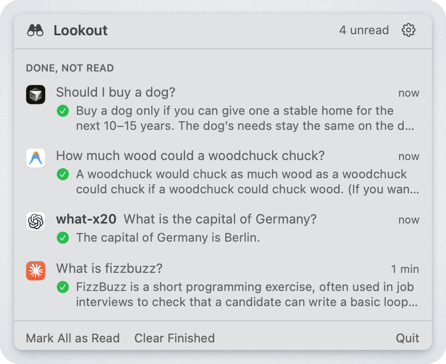

# Lookout

Lookout is a menu bar app for macOS that tells you when an AI coding agent needs you. It lists your agent sessions, sends a notification when one is waiting for a decision or has finished, and brings up the session's app when you click it.

It works with Claude Code, Codex, Cursor, Antigravity, Amp and Hermes. You choose which ones it watches.



## What you need

- macOS 13 or later.
- Xcode, or the Xcode Command Line Tools, to build the app. To install the Command Line Tools, run `xcode-select --install`.
- An Apple Development certificate, so macOS lets Lookout show notifications. A free Apple ID is enough:
  1. Open Xcode, then Xcode > Settings > Accounts.
  2. Add your Apple ID.
  3. Choose Manage Certificates, click +, and choose Apple Development.

## Get started

1. Download the code and build the app:

   ```bash
   git clone https://github.com/acjacobson/lookout.git
   ```

   ```bash
   cd lookout && ./scripts/build-app.sh
   ```

2. Copy the app to your Applications folder and open it:

   ```bash
   cp -R build/Lookout.app /Applications/ && open /Applications/Lookout.app
   ```

3. A binoculars icon appears in the menu bar. Click it, then click the gear icon in the panel.
4. Under **Agents**, turn on each agent you use. Lookout shows what it set up, and any step left for you.
5. Turn on **Launch at Login** in the same menu.
6. Allow notifications when macOS asks.

Start a session in one of your agents. It appears in the panel while it works, and you get a notification when it finishes or needs you.

## Notes for each agent

- **Claude Code:** sessions that were already open before you connected it need a restart.
- **Codex:** Codex runs new hooks only after you trust them. Run `/hooks` in the Codex CLI, or open Settings > Hooks in the ChatGPT app, and approve the Lookout entries.
- **Cursor:** clicking a session opens its chat in Cursor's Agents window. Cursor's hooks don't report when a chat waits for your approval, so such a chat may still show as working.
- **Antigravity:** clicking a session brings the Antigravity app or IDE forward, without selecting its conversation. If new conversations don't show up in Lookout, restart Antigravity.
- **Amp:** needs the Amp CLI, signed in with `amp login`. Lookout uses it to follow your threads, including threads from the Amp app.
- **Hermes:** restart Hermes after connecting it.

## Updating

Pull the latest code, then repeat steps 1 and 2 of "Get started". Quit Lookout first, so the copy replaces the running app:

```bash
git pull && ./scripts/build-app.sh
```

```bash
rm -rf /Applications/Lookout.app && cp -R build/Lookout.app /Applications/ && open /Applications/Lookout.app
```

## If notifications don't appear

Open System Settings > Notifications > Lookout and check that notifications are allowed. If Lookout isn't listed, or macOS never asked, the app was built without an Apple Development certificate. The build prints "Signed ad hoc" in that case. Add a certificate as described in "What you need", then build and copy the app again.

Lookout doesn't notify you about a session whose app is already in front, since you're looking at it.

## More

- [Agents on other machines](docs/remote-agents.md): show sessions from agents on a server or another computer, over Tailscale.
- [How Lookout works](docs/how-it-works.md): the hooks it installs for each agent, how it tracks sessions, and how to install hooks from a terminal.

## License

MIT. See [LICENSE](LICENSE).
